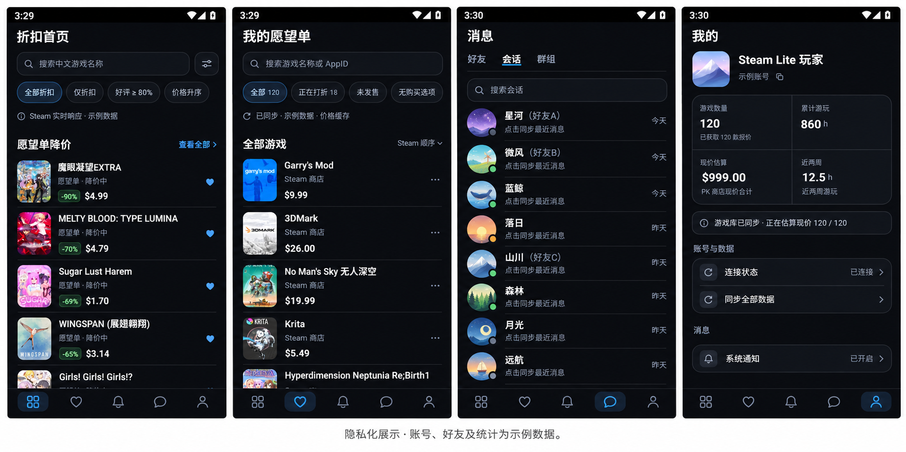

<div align="center">

# Steam Lite 1.0

**原生 Android Steam 客户端 · 商店与愿望单 · 好友聊天 · 动态**

[](https://github.com/zianyx6/steamlite/releases/download/v1.0.0/SteamLite-1.0.0.apk)

### [⬇️ 直接下载 SteamLite-1.0.0.apk](https://github.com/zianyx6/steamlite/releases/download/v1.0.0/SteamLite-1.0.0.apk)

[发行说明与全部附件](https://github.com/zianyx6/steamlite/releases/latest) · [问题反馈](https://github.com/zianyx6/steamlite/issues) · [MIT License](LICENSE)

Android 8.0 及以上 · 包名 `org.steamlite` · 无需自行编译

</div>

## 界面预览



展示图经 AI 隐私化编辑，账号、好友头像、昵称、备注及统计为虚构示例，价格仅用于界面展示。

## 安装

1. 点击上面的 **直接下载 APK**。不要下载 GitHub 自动提供的 Source code，那是源码。
2. 在 Android 上打开 APK，按系统提示允许该下载来源安装应用。
3. 已使用此前同签名测试版的用户可直接覆盖安装，保留本地数据。
4. 进入“我的”登录 Steam。可等待官方手机应用批准，也可直接提交 Steam Guard 令牌码；按 Steam 实际提供的认证方式完成登录。

应用直接连接 Steam，会话由 Android Keystore 保护。密码不保存在应用中，也不发送至开发者服务器。

## 功能

- **商店与愿望单**：游戏封面、折扣售价、搜索筛选、游戏详情、愿望单添加与移除回读确认。
- **好友与会话**：在线状态、按游戏人数分组、Steam 置顶与备注、灰色括号备注、滑动操作菜单、未读蓝点。
- **聊天**：实时私聊与历史补拉、图片发送/查看/保存、Steam 表情与 APNG 动态贴纸、好友私聊语音通话。
- **群组**：群组侧栏、文字频道、群头像与群聊历史。
- **动态**：好友 Steam 活动、图片预览与原图查看。
- **我的**：游戏数量、游玩时长与已获取报价估算；统一“同步全部数据”入口。

底栏固定为 **商店 → 愿望单 → 动态 → 消息 → 我的**，消息默认进入“会话”。

## 已知边界

- 主要实测环境为 Android 12 MuMu；其他 Android 版本、厂商后台策略和部分网络环境仍需反馈验证。
- 语音通话限好友私聊与前台使用；群语音、视频通话和完整群管理尚未提供。
- 需要能够访问 Steam 社区、聊天与图片 CDN。限流时会停止继续查询价格，保留已加载数据；完整同步可能有部分项目未完成。
- 商店报价采用 PK/USD 查询上下文，游戏价值是已获得的当前报价合计，不是购买支出；价格观察不代表全历史最低价。
- 真实手机确认/令牌双通道的所有竞争与异常场景、群组在线头像，以及部分网络下的整轮同步仍需持续验收。

完整说明见 [KNOWN_ISSUES.md](KNOWN_ISSUES.md)。

## 开发

Kotlin、Jetpack Compose、JavaSteam、Room、OkHttp、Coil。使用 JDK 17、Android SDK 35 和仓库 Gradle Wrapper：

```sh
./gradlew testDebugUnitTest assembleDebug
```

当前有 63 项 JVM 回归测试。构建、签名和设备检查见 [docs/BUILDING.md](docs/BUILDING.md)，1.0 更新记录见 [CHANGELOG.md](CHANGELOG.md)。

本项目为非官方开源客户端，与 Valve 无关联。Steam 商标属于其权利人。源码采用 MIT 许可证，第三方信息见 [DEPENDENCIES.md](DEPENDENCIES.md) 和 [third-party/](third-party/)。
